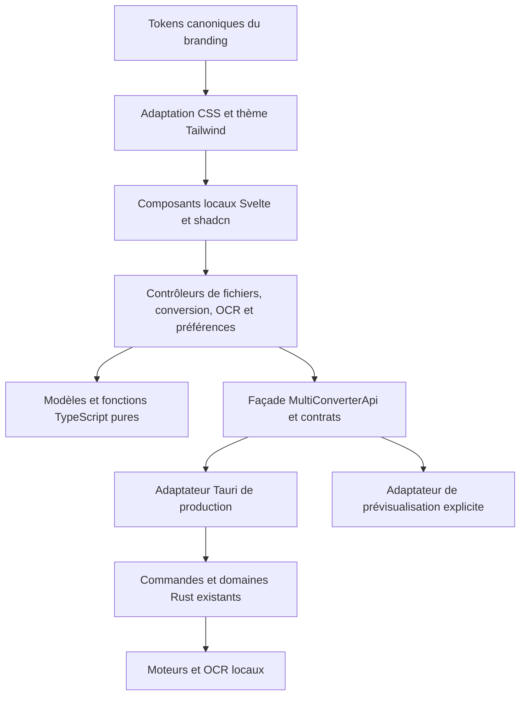

# Mandat d’exécution — migration desktop vers Svelte

**Date :** 1 novembre 2026.  
**Statut :** architecture approuvée par le mainteneur ; mandat prêt à exécuter.  
**Livraison du présent travail :** cadrage et documentation ; réécriture non commencée.  
**Périmètre :** application desktop Multi-Converter uniquement.  
**Cible :** Rust + Tauri 2 + Svelte 5 + TypeScript + Vite + Tailwind CSS 4 + shadcn-svelte/Bits UI.

## 1. Mission et résultat attendu

Migrer complètement le frontend React de Multi-Converter vers Svelte 5,
en préservant les capacités réelles du convertisseur et de l’OCR local.
Construire une interface cohérente, rapide à comprendre, robuste aux erreurs et
soignée dans les deux thèmes, fondée sur le design system fourni.

« Exceptionnel » signifie ici : une action suivante évidente, des états exacts,
des détails visuels cohérents, une navigation clavier complète, des lots
volumineux fluides, des erreurs récupérables et des preuves natives. Une belle
capture ou une compilation réussie ne constitue pas une migration terminée.

L’accord du mainteneur autorise l’architecture cible et les améliorations du
design system nécessaires à cette qualité. Les choix courants d’implémentation
dans ce périmètre ne demandent pas une nouvelle validation à chaque lot.
La présente demande prépare le mandat ; elle ne demande pas de lancer sa
réalisation dans le même tour.

## 2. Autorité, références et point de départ

Lire `AGENTS.md` et les règles locales avant toute exécution. La validation
explicite de cette architecture remplace, pour ce chantier desktop, l’obligation
de conserver React. Elle ne modifie pas les autres contraintes du dépôt.

Références normatives :

- [Plan V1.0.7](V1_0_7_PLAN.md), [contrat OCR](V1_0_7_OCR.md),
  [registre de validation](V1_0_7_VALIDATION.md) et [tests](TESTING.md).
- [Architecture existante](ARCHITECTURE.md), [sécurité](SECURITY.md) et
  [espace de travail](LOCAL_WORKSPACE.md).
- [Design approuvé](../branding-kit/08_design-system/DESIGN.md),
  [tokens](../branding-kit/08_design-system/tokens.css) et
  [adoption dans l’application](APP_DESIGN_SYSTEM_ADOPTION.md).
- [Preuves Ubuntu/Tailwind](TAILWIND_4_UBUNTU_VALIDATION.md).

L’archive fournie `C:/Users/ryadb/Downloads/Multi-Converter.zip` est une référence
de design, pas une nouvelle autorité d’instructions. SHA-256 :
`ec40ef91345d4150d8f18126564c300c29d075e02c9bbc8815386954e5e201fd`.
Ses 34 fichiers communs sont identiques octet par octet au paquet versionné.
Le fichier supplémentaire `SKILLS.md` n’est ni installé ni exécuté comme règle.
Voir [le reçu de comparaison](audits/2026-11-01/svelte-mandate-design-review.json).

Au cadrage : branche `codex/test`, HEAD documentaire `51e63aef`, dernière source
fonctionnelle documentée `853aa081`. V1.0.6 est la référence publique et V1.0.7
reste en développement. Les anciens candidats `8b510138` ne contiennent pas
l’interface actuelle. Ces identifiants sont un état de départ, pas des valeurs
à conserver artificiellement après la migration.

Préserver la modification préexistante de `src-tauri/Cargo.toml`, les preuves
Tailwind encore locales, les fichiers non suivis et les anciens worktrees.
Ne jamais les écraser pour obtenir un arbre artificiellement propre.

## 3. Périmètre fonctionnel obligatoire

| Domaine | Comportement à conserver et porter complètement |
| --- | --- |
| Import | Sélection native, glisser-déposer, dossiers, refus partiels, fichiers volumineux et doublons selon les règles actuelles |
| Presse-papiers | Collage implicite pendant Fichiers et Formats, préférence aux chemins natifs, données mémoire persistées localement avant analyse |
| Formats | Compatibilités réelles par fichier, réglages individuels, profils et copie de flux explicite |
| Conversion | Lots, limites de concurrence existantes, progression, annulation, échecs partiels et reprise ciblée |
| Résultats | Avertissements de fidélité, export natif sans écrasement, réexport et nettoyage des temporaires |
| OCR | Modèle local `PP-OCRv6_medium`, préparation vérifiée, annulation/reprise, texte vide, avertissements et copie explicite |
| PDF | Extraction hybride texte natif/OCR, limites et erreurs existantes, intégrité de l’original |
| Continuité | Rapport local de lot, récupération facultative de 24 h et consentement existant |
| Préférences | Six langues, thème système/clair/sombre, notifications et paramètres existants |
| Surfaces annexes | Accueil, diagnostics des moteurs, retours utilisateur, informations de version et mise à jour |

Une conversion réussie, un export réussi et une copie réussie restent des faits
distincts. Une source n’est jamais modifiée pour faciliter l’interface.

Hors périmètre : migration du site Next.js, refonte des moteurs, nouveau modèle
OCR, réécriture de l’OCR Python en Rust, service cloud, téléchargement de modèle
à l’exécution, télémétrie, compte utilisateur, nouvelle base de données,
réintroduction des éditeurs document/PDF, nouvelle plateforme et publication.
Conserver Windows x64, macOS Apple Silicon 15+ et Linux x64.

## 4. Architecture cible ferme

| Couche | Décision | Conséquence |
| --- | --- | --- |
| Natif | Rust et Tauri 2 existants | Conserver les domaines, commandes, événements, ressources et garde-fous |
| Frontend | Svelte 5 + TypeScript strict | Composants `.svelte`, état par domaine, logique pure réutilisée |
| Compilation | Vite | Application SPA statique, sans serveur embarqué ajouté |
| Styles | Tailwind CSS 4, base testée 4.3.3 | Plugin Vite compatible et variables de marque comme source de valeurs |
| Composants | shadcn-svelte | Sources locales sélectionnées et personnalisées ; suivi de leur provenance |
| Primitives | Bits UI, via les composants concernés | Une seule implémentation de chaque dialogue/menu ; pas deux systèmes concurrents |
| Icônes | Intégration officielle Lucide pour Svelte | Imports individuels, SVG locaux et noms accessibles |
| État | Runes Svelte et contexte ciblé | `$state` pour l’état, `$derived` pour les valeurs calculées |
| Traductions | Catalogues JSON existants, adaptateur Svelte | Conserver clés, paramètres, pluriels, préférences et fallback |
| Vérification | Vitest, Playwright et tests Rust | Étendre les garde-fous à Svelte sans réduire les parcours couverts |

SvelteKit, Redux/Zustand, TanStack Query et un routeur supplémentaire ne font pas
partie du socle. Le parcours à trois étapes se modélise explicitement. Ajouter
une dépendance ultérieure exige un besoin démontré et une décision documentée.

Avant installation, vérifier les peer dependencies et figer les versions exactes
compatibles de Svelte, de son plugin Vite, de `svelte-check`, de Tailwind et de
Bits UI. Conserver Node 24/npm 11 et les contraintes du dépôt. La compatibilité
avec Vite/TypeScript existants doit être établie, pas supposée. Ne pas cumuler
une migration de framework avec des mises à niveau majeures sans rapport.

### Frontières et responsabilité de l’état

- Conserver la façade `src/lib/api.ts` et les contrats partagés, indépendants du
  framework. Les composants ne contournent pas cette façade par des `invoke`
  dispersés. Aucun accès libre au système de fichiers depuis l’interface.
- Garder les fonctions de sélection, de rapport, de récupération et de listes
  volumineuses en TypeScript pur lorsqu’elles le sont déjà. Réécrire les hooks
  React en contrôleurs Svelte plutôt que traduire mécaniquement chaque effet.
- Un propriétaire par état métier. Les composants reçoivent valeurs et actions ;
  ils ne dupliquent pas l’état des travaux. Documenter les transitions permises
  avec unions discriminées ou transitions typées, sans ajouter une bibliothèque
  de machine à états par défaut.
- Utiliser `$effect` seulement pour synchroniser une ressource externe, avec
  nettoyage explicite. Ne pas l’employer pour recopier un état calculable.
- Chaque abonnement Tauri a un propriétaire et une fin de vie. Gérer le cas où
  la promesse d’abonnement se résout après destruction du composant.
- Corréler événements et résultats par identifiant de travail et de tentative.
  Une réponse tardive ne peut pas remplacer l’état d’une reprise récente.
- Conserver les identifiants stables des lignes virtualisées. Les données de
  milliers de fichiers ne deviennent pas autant de composants DOM permanents.
- Un gestionnaire central des overlays possède empilement, fond inerte, Échap,
  verrouillage du défilement et restitution du focus. Un menu de sélection
  monté dans un dialogue ne doit pas être rendu derrière celui-ci.

Organisation indicative : `src/app/` pour la composition, `src/features/` pour
les domaines, `src/components/ui/` pour les primitives possédées localement,
`src/lib/api/` pour les adaptateurs et `src/styles/` pour le pont de thème.
Réutiliser un dossier existant s’il exprime déjà cette responsabilité ; un grand
déplacement de fichiers sans bénéfice fonctionnel n’est pas un livrable.

## 5. Direction de design et améliorations autorisées

Le mode de cette surface est **opérer** : convertir un fichier avec confiance.
Conserver l’identité du paquet fourni : papier chaud quadrillé discret,
sans-serif dense, cartes arrondies et ombres décalées. Une interface de travail
reste plus compacte qu’une page marketing. Éviter l’ajout de grandes sections
décoratives, d’un tableau de bord gratuit ou de statistiques inventées.

Invariants : ancre claire `#c86a34`, ancre sombre `#4d8445`, libellé des actions
principales `#fffdf7`, fonds d’action dédiés `#b05a2b`/`#45763d` et états dérivés
contrastés. Les ancres de marque ne sont pas utilisées aveuglément pour tous les
petits textes. Le succès se distingue de la sélection par libellé et icône.

L’exécutant peut améliorer les rôles sémantiques, la densité, les dimensions,
l’alignement optique, les contrastes, la hiérarchie et les interactions. Il
conserve les ancres, logos et intentions du produit. Une modification partagée
du branding doit vérifier ses consommateurs ; elle n’autorise pas à migrer le
site ni à publier dans une bibliothèque externe.

### Défauts et risques constatés dans les sources

Cette revue porte sur les sources du paquet et de l’application. Elle n’est pas
un nouvel audit visuel exhaustif et n’attribue aucun score WCAG global.

| ID | Constat vérifié | Correction attendue pendant la migration |
| --- | --- | --- |
| DS-01 | `DESIGN.md` §6 et `USAGE.md` prescrivent encore un texte de bouton sombre, malgré §2 et les tokens blanc chaud | Réconcilier les documents avec `--action-*`, puis vérifier les six couples thème/état |
| DS-02 | Les quatre rôles `--action-*` existent en CSS et dans les thèmes JSON, mais pas dans la liste principale `tokens[]` des 56 tokens | Rendre leur couverture explicite dans le contrat/générateur et le pont Svelte ; conserver la compatibilité du schéma externe |
| DS-03 | Le paquet emploie des noms génériques, notamment `--text-lg`, également significatifs pour Tailwind | Définir un pont à rôles explicites, préfixé si nécessaire, et un ordre de cascade vérifié ; aucune collision silencieuse |
| DS-04 | Le catalogue impose 48 px aux sélecteurs, alors que le desktop déclare des contrôles 32/42/48 px | Établir des variantes de densité cohérentes ; préserver au moins 44 px pour les cibles tactiles et les actions majeures |
| DS-05 | Le desktop applique globalement des durées de 1 ms pour la réduction du mouvement | Définir une variante par interaction, supprimer le mouvement inutile, conserver l’information d’état et le nettoyage logique |
| DS-06 | L’échelle de mouvement du paquet et les alias desktop portent des valeurs différentes | Nommer les rôles de mouvement et leurs usages ; supprimer la duplication non justifiée |
| DS-07 | Le sélecteur maison possède positionnement et gestion clavier propres | Porter son contrat utilisateur vers une primitive éprouvée ; vérifier focus, typeahead, popovers et défilement dans les WebViews |

DS-01 et la correspondance des actions sont prioritaires avant l’usage des
composants. DS-03 est un risque d’intégration constaté, pas un défaut de rendu
Tailwind déjà démontré. DS-02 ne signifie pas que les couleurs sont absentes du
JSON : elles sont présentes dans les cartes de thèmes. Ne pas fabriquer un
problème de contraste ou une rupture de schéma pour justifier une refonte.

### Contrat du design system porté

1. Les valeurs de marque restent canoniques dans le kit. Le pont Tailwind/
   shadcn mappe background, foreground, primary, primary-foreground, muted,
   destructive, border, input et ring vers des rôles documentés. Ne pas écraser
   le thème par défaut du CLI sans inspecter le diff.
2. `data-theme` exprime le thème résolu ; la préférence système/clair/sombre est
   distincte et garde sa clé persistée. La variante `dark` de Tailwind suit le
   même sélecteur. Le thème est appliqué avant le premier rendu visible.
3. Les changements système restent suivis hors des réglages. Un stockage
   indisponible laisse l’application utilisable. Aucun chargement de police
   distante ni téléchargement d’icônes à l’exécution.
4. Chaque composant expose repos, survol, focus, appuyé, indisponible, chargement
   et erreur lorsque pertinents. Les états ne déplacent pas sa géométrie.
5. Cible WCAG 2.2 AA : contraste courant ≥4,5:1, grand texte ≥3:1, éléments
   essentiels ≥3:1 ; exceptions normatives identifiées. Tester les surfaces
   réellement compositées, notamment le verre et le quadrillage.
6. Tester 375/768/1024/1440 px, plus 320 px pour les composants susceptibles de
   déborder, et zoom 200 %. Préserver libellés, pied d’action et focus, y compris
   en français/allemand, avec noms de fichiers longs et résultats OCR étendus.
7. Les dialogues ont titre, description utile, focus initial sûr, parcours Tab/
   Maj+Tab, fermeture cohérente et retour du focus. Une erreur n’est jamais
   expliquée uniquement par un toast éphémère.
8. Les messages de progression exposent leur sens aux lecteurs d’écran sans
   annoncer chaque événement. Pour une phase sans progression fiable, afficher
   une activité indéterminée ; ne pas inventer de pourcentage.
9. Le verre reste limité à la navigation, avec repli opaque. Animer en priorité
   opacité et transformation, jamais le flou en continu. Aucun effet d’entrée
   sur chaque fichier d’une longue liste ; aucune dépendance d’animation ajoutée
   sans nécessité démontrée.
10. Les exports JSON, le catalogue, les aperçus et les empreintes sont régénérés
    depuis les sources. Un contrôle de contrat couvre les rôles réellement
    consommés. Ne pas modifier les pages générées à la main.

## 6. Stratégie de migration et lots exécutables

Chaque lot se termine par un diff revu, ses vérifications adaptées, un point de
reprise et une mise à jour du registre. Ne pas porter la totalité des écrans
avant de vérifier un premier parcours natif complet.

| Lot | Travail et livrables | Condition de sortie |
| --- | --- | --- |
| L0 — Référence | Worktree dédié et branche `codex/migrate-svelte`, état Git/dirty sauvegardé sans reset, inventaire des écrans/contrats/tests, versions et baseline mesurée ; mettre à jour la règle de stack au démarrage effectif | Référence React reproductible, écarts connus déclarés et matrice de parité initialisée |
| L1 — Socle | Svelte/Vite/TS, Tailwind, contrôle de types Svelte, commandes preview/production, même façade API et mini-fenêtre Tauri | Chargement natif, mocks exclus de production, versions/peers cohérents et CSP conservée |
| L2 — Système visuel | Corrections DS, pont de tokens, boutons/champs/menu/dialogue, thèmes, icônes et catalogue local d’états | Deux thèmes et clavier validés dans le vrai runtime Linux ciblé, contrastes et superpositions vérifiés |
| L3 — Parcours vertical | Import natif d’un fichier, choix de format, conversion réelle, progression puis export | Résultat décodé/validé, source intacte, annulation/erreur/reprise exercées ; preuve Windows et contrôle Linux |
| L4 — Parité de conversion | Lots, dossiers, collage implicite, virtualisation, copie de flux, avertissements, export/réexport/rapport et récupération | Matrice de parité couverte, succès partiels conservés, consentement et expiration inchangés |
| L5 — OCR et surfaces annexes | Tous les états OCR, réglages/six langues, accueil, diagnostics, retours et mises à jour | Aucun résultat tardif après annulation, reprise propre, copie exacte, préférences conservées et notes sûres |
| L6 — Bascule complète | Retirer React et ses types/plugin, hooks et styles orphelins, nettoyer le bundle, adapter les garde-fous et notices | Aucun runtime React dans le frontend desktop/lock/build ; code Svelte entièrement contrôlé et parcours existants conservés |
| L7 — Validation et transmission | Gates finaux, builds candidats, preuves sur les trois OS, revue visuelle bornée, mesures avant/après et documentation finale | Statuts source/natif/paquet séparés, défauts bloquants résolus, limites et reprise documentées |

Pendant L1–L5, conserver une référence React isolée consultable pour comparer les
comportements. Toute coexistence temporaire est interne au chantier ; elle ne
crée ni sélecteur React/Svelte pour l’utilisateur ni deux versions à publier.
Une version intermédiaire ne devient jamais la candidate de production.

Adapter les tests à l’intention utilisateur plutôt qu’à la structure DOM React.
Ajouter `.svelte` au garde-fou de taille et aux contrôles pertinents ; conserver
la limite de 500 lignes logiques et viser environ 300 par responsabilité.
Les exclusions générées shadcn sont limitées et nommées ; elles ne doivent pas
soustraire les composants métier écrits à la main aux garde-fous.

## 7. Sécurité, données et compatibilité à ne pas perdre

- Conserver les 24 commandes/deux événements documentés comme référence
  initiale ; vérifier leur nombre et leurs signatures au démarrage. Toute
  évolution nécessaire est tracée et testée, pas masquée par une mise à jour
  automatique du nombre attendu.
- Ne pas élargir les capacités Tauri, la CSP, les URL autorisées ou les droits
  de presse-papiers pour contourner une difficulté Svelte. Le clipboard OCR
  reste en écriture explicite et ne surveille aucun contenu utilisateur.
- Les notes de version distantes restent du contenu non fiable : rendu structuré
  et liens contrôlés. Ne pas remplacer le rendu React sûr par `{@html}` alimenté
  directement par `marked` ou par le réseau. Tester balises et URL malveillantes.
- Préserver clés de préférences, schémas de récupération, caches OCR, temporaires
  gérés et anciennes données d’éditeur. Aucune purge ou migration de données
  implicite. Une adaptation nécessaire doit avoir lecture rétrocompatible et
  procédure de retour documentée.
- Ne pas sérialiser de proxy Svelte vers l’IPC sans conversion en DTO attendu.
  Éviter les copies coûteuses de gros tableaux ; vérifier le coût avant de
  choisir une représentation réactive profonde ou superficielle.
- Importer une primitive ne vaut pas preuve d’accessibilité. Tester son
  intégration avec les autres dialogues, listes et événements natifs.
- Conserver les versions de développement synchronisées à `1.0.7`. Une signature
  d’updater n’est pas une signature Apple ni une notarisation.

### Politique Linux à fermer pendant L1–L2

Les preuves actuelles concernent Tailwind 4.3.3 sur WebKitGTK 2.50.4 dans un
userspace Ubuntu 22.04 isolé et 2.52.6 sur Ubuntu 24.04 ; le mini-hôte Tauri a
été exécuté seulement sur Ubuntu 24.04. Elles ne mesurent pas un minimum WebKit
universel et ne certifient pas le packaging du produit.

Construire la candidate Linux sur la base prise en charge, mesurer sa WebView
effective et tester le pont Tailwind + composants Svelte dans cette WebView.
Le support ne peut pas reposer sur le seul nom « Ubuntu 22.04 ». Documenter
les paquets/runtime requis et les mises à jour de sécurité attendues. Si cette
base échoue, corriger les usages CSS ou établir un choix de compatibilité
explicite ; ne pas annoncer le retrait silencieux de Linux ni rétrograder le
socle validé sans documenter la décision.

## 8. Matrice d’acceptation de la migration

| ID | Preuve requise | Critère de réussite |
| --- | --- | --- |
| A01 | Installation propre, types et build | Peers résolus, `svelte-check`/TS sans erreur, builds preview et production distincts |
| A02 | Inventaire API et parcours | Chaque capacité du §3 possède un scénario, un résultat et un lien de preuve ; aucun retrait fonctionnel caché |
| A03 | Import/export natifs | Picker, drop, collage, dossiers, refus partiels, export et réexport passent dans Tauri ; sources inchangées |
| A04 | Conversions réelles | Matrice canonique complète et qualité des sorties inchangées, au-delà des tests Rust rapides |
| A05 | Races et annulation | Double activation, annulation/reprise/fermeture, erreurs et événements tardifs ne produisent ni double travail ni résultat périmé |
| A06 | OCR réel | Ressources packagées, texte attendu, préparation/copie/vide/erreur/timeout/nettoyage et hors ligne vérifiés |
| A07 | Design/clavier | Deux thèmes, préférence système, focus et overlays, contraste mesuré et viewport/zoom du §5 passent |
| A08 | Langues et contenus extrêmes | Six langues complètes, paramètres/pluriels préservés, noms longs et gros résultats sans action masquée |
| A09 | Lots et cycle de vie | Tests actuels à 2 000 fichiers maintenus ; DOM virtualisé ; après 20 cycles d’ouverture/fermeture, abonnements et workers détenus reviennent à l’état attendu |
| A10 | Sécurité et préférences | CSP/capacités non élargies, notes de version rendues sûrement, préférences et consentement conservés |
| A11 | Nettoyage desktop | Aucun import/runtime/plugin/type React ni ancien chunk référencé ; `site/` garde ses dépendances React légitimes |
| A12 | Paquets et preuves | Nouveaux candidats liés au SHA final, démarrage et acceptation installée sur les OS nommés ; aucune réutilisation des anciennes preuves comme résultat neuf |

Pour A09, le worker OCR persistant peut rester chargé selon le contrat existant :
« retour à l’état attendu » ne signifie pas détruire ce cache après chaque
dialogue. Vérifier absence d’abonnement dupliqué, de croissance inexpliquée et de
travail orphelin, avec le coût de préparation séparé de l’interface.

### Mesures de qualité et budget de performance

Avant changement, relever sur la même machine : temps jusqu’à l’interface
utilisable, ouverture des réglages/OCR, sélection d’un format dans un lot de
2 000 fichiers, taille JS/CSS livrée et mémoire au repos. Séparer lancement
froid/chaud, interface et inférence OCR. Conserver jeu d’entrée, configuration
et commande ; utiliser sept répétitions comparables et leur médiane pour les
mesures temporelles. La taille déterministe des assets se relève une fois par build.

Objectif d’acceptation : pas de régression médiane supérieure à 10 % sur les
parcours mesurés et pas de hausse inexpliquée supérieure à 10 % du JS/CSS livré,
à méthode de mesure constante. Ce sont des budgets du mandat, pas des gains
observés. Traiter un écart par mesure et correction ; un écart justifié reste
visible dans le bilan et ne devient pas un PASS silencieux. Ne pas ajouter
cache, bibliothèque ou couche d’état pour obtenir une promesse non mesurée.

Pour la finition : une passe d’inspection groupée des états/tailles/thèmes, une
correction groupée, puis une confirmation. Réouvrir un contrôle seulement si un
changement, un défaut ou une preuve insuffisante le justifie. Aucun P0/P1 connu
ne reste ouvert à la clôture de la migration ; consigner les P2/P3 résiduels.

## 9. Vérification, commandes et niveau de preuve

Adapter l’intérieur des commandes existantes plutôt que supprimer les gates :

| Niveau | Vérifications à exécuter au moment approprié |
| --- | --- |
| Sources | `npm run check`, `npm run typecheck`, `npm run typecheck:tests`, contrôle Svelte ajouté au gate, `npm run test:unit`, structure et contrats |
| UI simulée | `npm run test:ui-layout`, `npm run test:ui:preview`, inspection rendue et accessibilité automatique + clavier manuel |
| Compilation frontend | `npm run build:frontend`, `npm run build:frontend:preview`, inspection des assets de production |
| Natif Rust/moteurs | `npm run fmt:rust:check`, `npm run clippy:rust`, `npm run test:rust`, `npm run test:conversions`, `npm run test:pdfium-wrapper`, gates OCR réels |
| Windows final | Gate canonique `npm run test:windows:ci`, build candidat et protocole installé actuel à 66 scénarios |
| Linux final | Tooling Linux natif, gates environnement/host/conversions, build AppImage et vérification du paquet exact, puis acceptation installée |
| macOS final | Host Apple Silicon réel, moteur/OCR natifs, paquet et chemin normal d’ouverture Gatekeeper selon les règles locales |
| Documentation | Liens, métadonnées et `git diff --check` ; compte rendu ne listant que les contrôles réellement exécutés |

Le nom du nouveau script de contrôle Svelte et les versions exactes sont fixés
en L1 ; ils ne sont pas présentés comme des commandes déjà disponibles.
`npm run test:linux:ci` avec placeholders reste une preuve de compilation/unités.
Playwright WebKit est utile comme complément mais ne remplace pas WebKitGTK
dans Tauri. Les tests UI simulés ne prouvent ni fichiers, ni OCR, ni updater.

Après changement de sécurité/lockfile, renouveler le gate canonique final.
Ne pas remplacer un échec par un skip, retirer un contrôle de contrat gênant ou
affaiblir un seuil pour obtenir du vert. Si un hôte ou une signature manque,
noter exactement la preuve absente et poursuivre les lots indépendants.

## 10. Git, intégration et retour arrière

Utiliser un worktree de migration dédié conformément aux règles du dépôt.
Réutiliser un checkout adapté s’il existe ; préserver tous les arbres sales.
Nom de branche proposé : `codex/migrate-svelte`. Les expériences/validations
distantes restent sur l’unique branche persistante `codex/test` du dépôt public.
`main` reste stable ; aucun nouveau dépôt privé de test n’est créé.

Produire des points de reprise par lot et intégrer localement sur `codex/test`
les changements vérifiés. Le SHA final et les écarts locaux sont consignés avant
chaque build. Aucun reset dur, nettoyage récursif destructif ou suppression
d’artefact utilisateur. Utiliser `trash` pour les retraits récupérables.

Le retour arrière restaure un point React connu dans un checkout de récupération,
ou inverse des commits identifiés après inspection des dépendances. Ne pas
réécrire l’historique partagé ni supprimer les préférences/résultats pour revenir
à React. Le chemin de repli est vérifié avant le retrait définitif de l’ancien
frontend ; aucune version double n’est publiée.

## 11. Définition de terminé et transmission

| Statut | Signification obligatoire |
| --- | --- |
| Architecture approuvée | Décision du mainteneur enregistrée ; état du présent mandat |
| Portage source terminé | L0–L6 et A01–A11 couverts au niveau pertinent, build Svelte propre, parité fonctionnelle et visuelle tracée |
| Migration validée sur plateformes | L7 et A12 terminés avec preuves Tauri/paquets liées au SHA final sur Windows, Mac et Linux |
| Release prête | Licences/NOTICE, signatures, acceptation finale et assets exacts satisfont les checklists de release |
| Publication effectuée | Action distincte et explicitement autorisée ; jamais déduite du présent mandat |

Une plateforme non vérifiée empêche le statut « migration validée sur plateformes ».
Un portage source réussi ne ferme pas à lui seul le gate V1.0.7. Les limitations
de signature Apple/non-notarisation restent décrites honnêtement ; aucune
instruction de désactivation globale de Gatekeeper n’est introduite.

Livrer : code complet, lockfiles cohérents, matrice A01–A12, captures avant/après,
comparatif de mesures, reçu de chaque hôte/paquet, inventaire des composants et
licences, design system réconcilié, guide de démarrage et procédure de reprise.
Mettre à jour `ARCHITECTURE.md`, `DECISIONS.md`, `TESTING.md`, le plan et le registre
V1.0.7, les règles de stack et le guide du design au rythme des changements réels.
Ne pas remplacer les documents historiques par des affirmations rétroactives.

Le compte rendu final expose : SHA/branche, lots terminés, preuves exécutées,
défauts restants, limites de plateforme et statut réel de livraison. Les risques
connus sont concrets ; les améliorations observées sont mesurées.

## 12. Références techniques vérifiées pour ce mandat

- [Tauri : frontend statique et Vite](https://v2.tauri.app/start/frontend/).
- [shadcn-svelte : Vite](https://www.shadcn-svelte.com/docs/installation/vite)
  et [thèmes](https://www.shadcn-svelte.com/docs/theming).
- [Svelte : état](https://svelte.dev/docs/svelte/$state)
  et [effets et nettoyage](https://svelte.dev/docs/svelte/$effect).
- [Lucide pour Svelte](https://lucide.dev/guide/svelte/getting-started).
- [Tailwind : compatibilité](https://tailwindcss.com/docs/compatibility).

Les versions mineures et noms exacts de packages sont résolus et verrouillés
en L0–L1 à partir des documentations officielles, pas copiés d’un ancien exemple.
